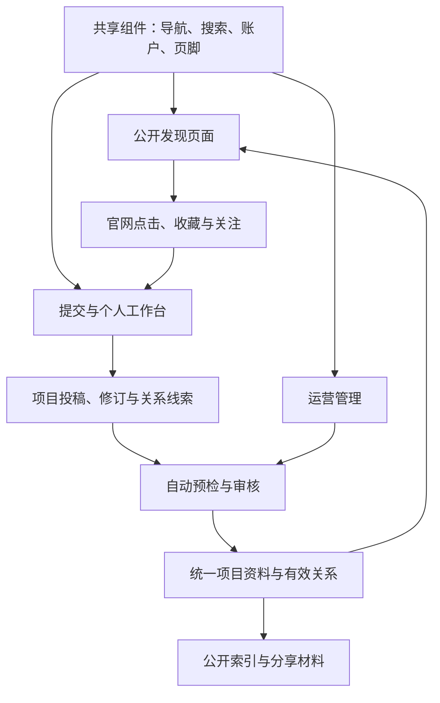
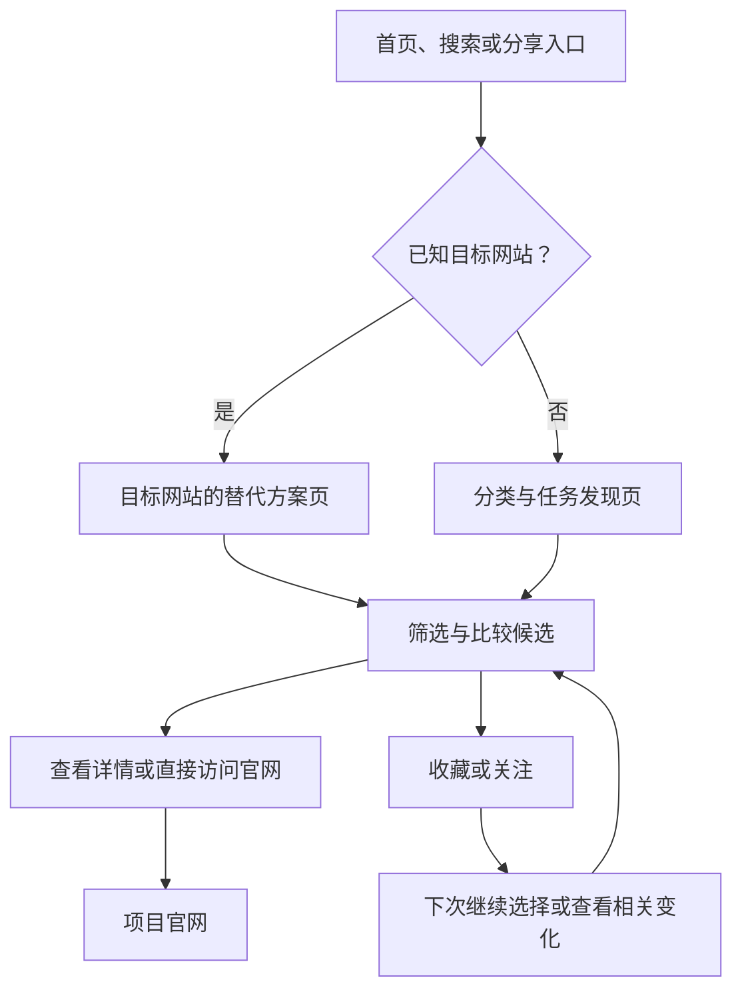
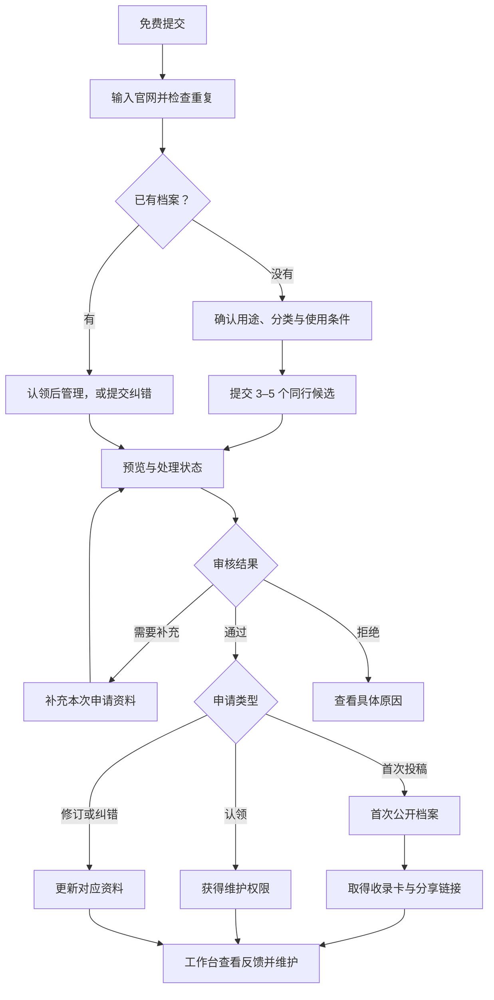
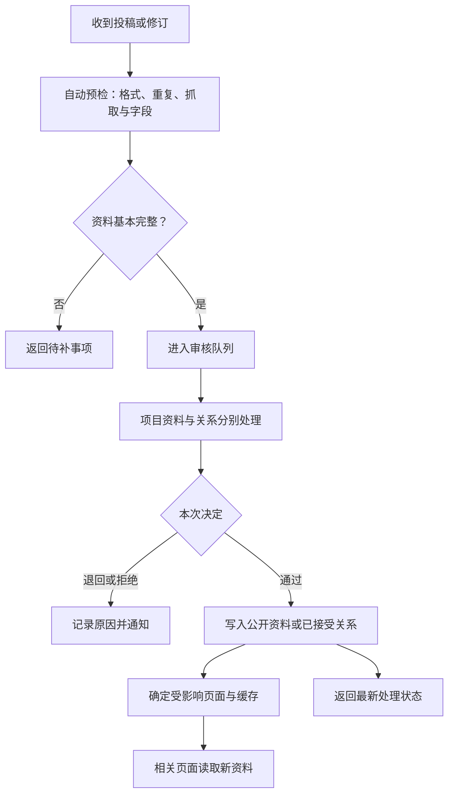
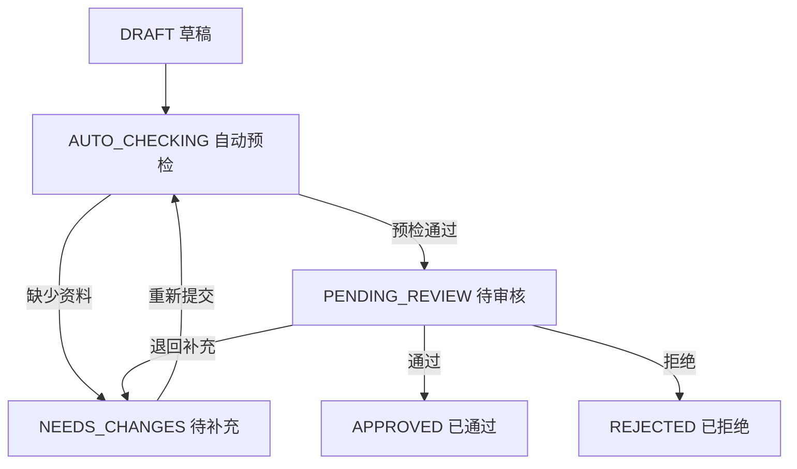
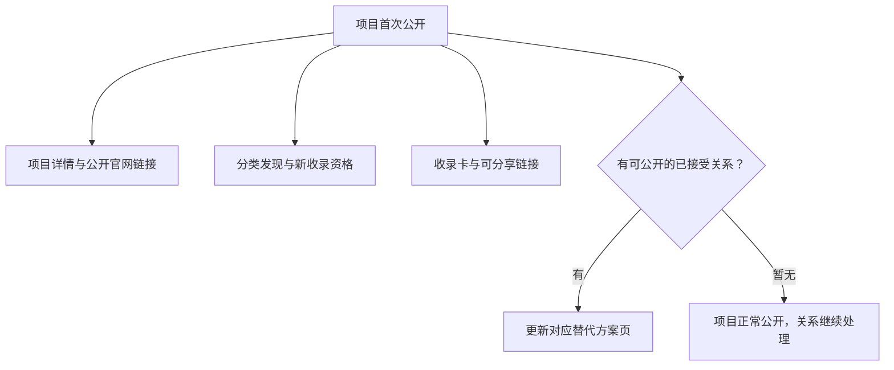
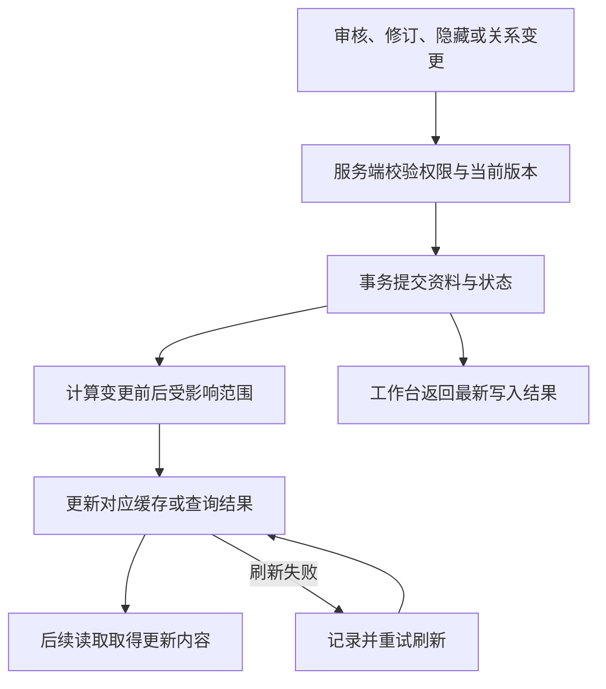
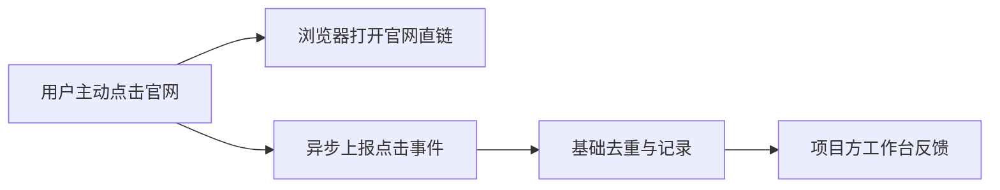
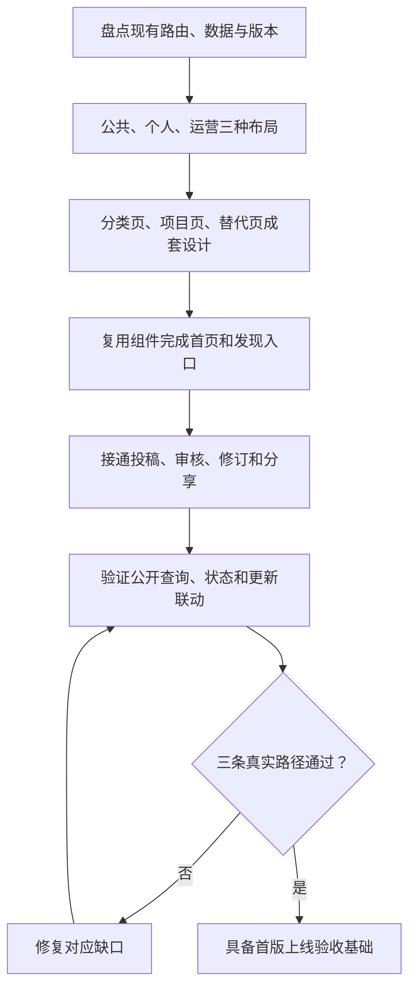

# 123Charts 全站架构与用户流转统一设计书

**图解版｜2026-10-21｜123charts.com**

用途：给产品设计、前端、后端和运营共用的页面树、流程图、状态机与数据映射。本文是目标设计，不是已实现报告。

范围：免费浏览、免费提交、免费正常审核；首次主动投稿提供 3–5 个同行候选；首版采用分类发现、新收录、免费可用和替代方案；截图 OCR、外部网站访问量排行与高价流量 API 留到后续。

技术示意采用用户给出的 Next.js App Router。实施时先核对现有仓库版本、路由、数据库与缓存配置，优先复用已有能力；本文不要求升级技术栈或另建应用。

## 2026-10-22 当前资料分工补充

平台整理项目简介、分类与官网入口即可形成基础档案，不要求平台补齐价格、语言、特点和部署条件；已审核公开的基础档案可正常发现。扩展资料由项目方认领后补充，页面提供可复制的 AI 核实提示词与 JSON 草稿导入。AI 输出和其来源记录属于提交资料，不自动取得身份、价格核验、替代关系或公开资格。已有补充资料保留为参考，不因认领而自动标成项目方提供。现有认领、修订审核、首次公开时间和免费纠错继续生效。

## 一、全局架构总览



| 层级 | 模块 | 边界 |
| --- | --- | --- |
| 共享界面层 | Header、全局搜索、语言、账户、Footer | 公共导航统一；侧栏按页面场景出现 |
| 公开发现层 | 首页、分类、项目、替代、免费、开源、新收录 | 只读取公开项目与允许公开的关系 |
| 个人工作层 | 投稿、草稿、管理项目、收藏、关注、反馈 | 同一账户兼具访客和项目方能力 |
| 运营层 | 审核、分类、关系、认领、纠错 | 使用服务端权限控制 |
| 数据与更新层 | 项目、关系、公开查询、缓存刷新、基础事件 | 同一应用内部模块；首版一个数据库即可 |

**公共导航：Logo（首页）｜分类榜单｜找替代方案｜免费 / 开源｜搜索｜免费提交｜语言｜账户。**

公共侧栏只承担当前分类或筛选。工作台、通知和运营管理不再复制到公共侧栏。

## 二、全站页面与组件树

以下为 URL 与组件的目标层级；`[lang]` 采用现有 `zh` / `en` 等语言前缀。已有等价路径优先沿用；个人空间的 `/dashboard` 与此前 `/me` 是同一逻辑区域，选择仓库已有前缀，不建设两套。

- **123charts.com：共享组件**
  - `Header`：Logo、公共导航、免费提交、账户、语言。
  - `GlobalSearch`：任务、产品、域名；Cmd/Ctrl+K 可复用已有能力。
  - `ContextSidebar`：仅分类页或相应工作区使用，不重复顶部导航。
  - `Footer`：规则、关于、联系、隐私与使用说明。
- **公开发现区 `PublicLayout`**
  - **`/[lang]`：首页**
    - `HeroSearch`：标题与全局搜索。
    - `CategoryGrid`：重点分类、用途说明、真实公开收录数。
    - `DiscoveryShelf`：本期发现、有限新人位置与贡献推荐。
    - `NewListings`：最近首次收录的项目。
    - `AlternativeCollections`：已有内容的替代专题。
    - `FreeAndOpenSourceLinks`：免费与开源两种入口。
  - **`/[lang]/categories`：分类索引**
    - 分类搜索、一级领域、细分任务、公开项目数量。
  - **`/[lang]/categories/[slug]`：分类发现页**
    - `CategoryHeader`：分类定义、面包屑、关注分类。
    - `DiscoveryViews`：发现推荐、新收录、免费可用、找替代方案。
    - `FilterBar`：价格方式、界面语言、开源、当前选中条件。
    - `ProductResults`：项目列表、官网入口、收藏、分页。
    - `TargetSelector`：切换“找替代方案”后选择具体目标，再进入目标替代页。
    - `EmptyState`：零结果原因、清除筛选、相近分类。
    - `MethodNote`：当前展示规则与资料说明。
  - **`/[lang]/new`：新收录**
    - 分类筛选、按首次公开时间排序的项目列表。
  - **`/[lang]/free`：免费可用**
    - 持续免费条件、分类与语言筛选、免费范围、项目列表。
  - **`/[lang]/open-source`：开源发现**
    - 开源属性、许可/仓库信息、可选的价格筛选、项目列表。
  - **`/[lang]/alternatives`：替代方案入口**
    - 目标网站搜索、现有目标选择器、相关分类。
  - **`/[lang]/alternatives/[slug]`：目标网站替代页**
    - `TargetHeader`：正在替代哪个网站、哪项任务。
    - `UseCaseSelector`：有多种用途时选择任务。
    - `ComparisonTable`：价格方式、免费限制、用途、特点、官网。
    - `AlternativeList`：已确认的候选及其适用原因。
    - `SaveFollowActions`：收藏候选、关注这个替代入口。
    - `SourceAndCorrection`：资料来源、更新时间、纠错。
  - **`/[lang]/products/[slug]`：项目详情**
    - `ProductHeader`：名称、图标、域名、归属状态、官网按钮。
    - `ProductFacts`：用途、适用对象、条件与限制。
    - `PricingAndAccess`：价格、免费范围、界面语言、开源等。
    - `RelatedComparison`：已确认关系形成的同类对照。
    - `AlternativesEntry`：查看该项目的替代选择。
    - `PublicShare`：公开链接和真实收录卡片。
    - `ClaimAndCorrection`：认领、纠错、资料来源。
  - **`/[lang]/search`：站内搜索**
    - 名称/域名/任务匹配、结果筛选、精确项目与替代入口。
  - **`/[lang]/how-it-works`：平台规则**
    - 免费范围、收录、发现推荐、贡献、赞助、资料纠错。
- **投稿与个人区 `PersonalLayout`**
  - **`/[lang]/submit`：三步提交**
    - Step 1：官网、重复检测、Meta 预填与手动修正。
    - Step 2：确认分类、用途、语言、价格、特点。
    - Step 3：选择或粘贴 3–5 个同行候选。
    - 提交结果：草稿预览、处理状态、待补事项。
  - **`/[lang]/dashboard/projects`：我的项目**
    - 现有公开项目、本人投稿状态、认领入口。
  - **`/[lang]/dashboard/projects/[id]`：项目管理**
    - 资料与修订。
    - 同行关系及处理状态。
    - 实际展示、主动官网点击与来源。
    - 分享材料、公开页链接。
  - **`/[lang]/dashboard/bookmarks`：我的收藏**
    - 候选清单、分类筛选、取消收藏。
  - **`/[lang]/dashboard/following`：我的关注**
    - 项目/分类/替代入口、更新类型、取消关注。
  - **`/[lang]/dashboard/notifications` 与 `/[lang]/dashboard/settings`**
    - 仅本人相关的状态消息、账户与通知设置。
- **运营区 `AdminLayout`**
  - **`/[lang]/admin/review`**：统一审核队列；投稿、修订、关系、认领、纠错。
  - **`/[lang]/admin/products`**：公共资料、重复归并、隐藏与恢复。
  - **`/[lang]/admin/categories`**：分类与用途维护。
  - **`/[lang]/admin/relations`**：目标、候选、共同用途和关系状态。
  - **`/[lang]/admin/discovery`**：轮换规则和有限贡献推荐。
- **索引与接口层**
  - **`/sitemap.xml`**：只纳入符合索引策略的公开页面。
  - **`/robots.txt`**：抓取指引；不承担私人页面的身份控制。
  - **`/llms.txt`**：可选公开目录摘要，不作为上线前置条件。
  - **`POST /api/v1/submissions`**：提交或修订。
  - **`POST /api/v1/reviews/[id]/decision`**：服务端鉴权后的审核决定。
  - **`POST /api/v1/events/impression`**：实际可见卡片曝光事件，供反馈与轮换使用。
  - **`POST /api/v1/events/outbound`**：主动官网点击事件，基础去重。

### 分类页四入口的行为

| 分类内入口 | 组件 | 返回内容 |
| --- | --- | --- |
| 发现推荐 | `ProductResults` | 相关且符合条件的推荐候选 |
| 新收录 | 同一列表，按首次公开时间排序 | 在本分类内最近收录的项目 |
| 免费可用 | 同一列表，按免费条件筛选 | 持续免费使用或持续免费方案 |
| 找替代方案 | `TargetSelector` | 先选择目标网站，再打开对应替代页 |

“找替代方案”不能把整个分类的所有关系混成一张没有目标的榜。开源独立于免费；免费试用单列。待审草稿不进入公共结果，公开项目的未知价格采用字段级提示。

### 首页与分类页的曝光机制

| 展示区 | 首版规则 | 项目方得到什么 |
| --- | --- | --- |
| 发现推荐 | 先匹配分类/任务和公开条件；在合格候选中，近期实际曝光较少者优先，再稳定随机轮换 | 持续参与相关发现的机会 |
| 新收录 | 按首次公开时间倒序；另在发现推荐中保留有限新人位置 | 首次收录后的展示机会，不保证访问人数 |
| 贡献推荐 | 纠错、有效资料或相关关系被采纳后，增加有上限的轮换机会 | 贡献反馈与额外展示资格 |
| 替代方案 | 先符合目标任务和已接受关系，再按页面选择的条件排序或轮换 | 在真正相关的目标页面中被发现 |
| 赞助位（后续） | 独立位置、明确标记“赞助”，不改变普通结果顺序 | 可核对的商业曝光 |

首版不需要综合热度分。列表位置、轮换资格和实际可见曝光分别记录；点击是用户主动访问官网的动作，不能用刷新页面或反复提交来获得额外资格。随机顺序在同一浏览会话内保持稳定，翻页不会反复跳动。免费/开源属于筛选属性，不代表质量名次。

## 三、三类用户的使用路径

### 路径 A：普通用户



浏览、比较和访问官网无需登录。收藏或关注时登录，保留当前对象与返回位置。官网链接直接可用，点击记录异步处理，统计失败不阻断官网访问。

### 路径 B：创业者 / 项目方



首次投稿提供 3–5 个不同、可识别、合理相关的同行候选；真实例外可说明。提交前登录并保留已填写的草稿。已有项目的普通修订不重做整套首次任务。提交立即产生的是预览与处理状态，公开档案和正式分享材料在发布后提供。

认领和内容修订独立：认领通过只赋予管理权，不批准其全部内容修改，也不提高质量等级。

### 路径 C：系统与运营



首版默认采用自动预检加轻量审核。以后启用自动批准时，应采用明确的内容规则并调用同一批准逻辑；HTTP 成功、Meta 抓取成功不等于审核通过。

## 四、提交、公开、关系与认领的状态机

### 1. 投稿 / 修订状态机



`AUTO_CHECKING` 可以是处理进度字段，不必为了图示新建独立任务系统。

### 2. 其他状态独立维护

| 对象 | 状态变化 | 规则 |
| --- | --- | --- |
| 项目公开状态 | `UNPUBLISHED → PUBLISHED → HIDDEN → PUBLISHED` | 首次公开时间只写入一次；恢复不重置 |
| 替代关系 | `PENDING → ACCEPTED / REJECTED`；接受后可 `REVOKED` | 只有已接受且满足公开条件的关系进入替代页 |
| 维护权 | `PENDING → VERIFIED / REJECTED`；可撤销 | 只决定谁能维护，不认证质量 |
| 资料修订 | 待审、通过、退回、拒绝 | 待审修订不覆盖原公开内容 |
| 官网可用性 | 可用、待核查、已停止 | 一次请求失败不能直接判永久关闭 |

### 3. 四个联动条件

1. **首次通过并公开**：在同一业务动作中写入审核决定、公开资料和首次公开时间。
2. **公开项目修订通过**：更新公开版本，首次公开时间保持原值；被隐藏项目不会因为普通修订通过而自动恢复。
3. **项目通过、部分关系待审**：项目可以公开，待审关系继续留在工作台，不提前进入对应替代页。
4. **竞品未注册或未认领**：平台仍可依据公开资料建立基本条目与关系，无需对方先入驻；被动条目不要求递归提交同行。

## 五、数据提交与页面展示映射

字段名称为建议的业务字段，不代表现有数据库已采用这些名称。

| 输入 / 事件 | 数据对象 | 展示目标 | 生效条件 |
| --- | --- | --- | --- |
| 官网 URL | `products.official_url`、稳定 `id` | 项目页、卡片官网入口 | 项目公开，URL 已规范化 |
| 名称、用途、特点 | `products` / 多语言资料 | 首页、分类、搜索、项目页、分享卡 | 当前公开版本 |
| 分类与任务 | 分类关系、任务标签 | 分类页、发现候选、相关搜索 | 分类有效且项目公开 |
| 免费或收费方式 | `price_type`、免费说明、来源 | 价格标签、免费筛选、比较表 | 已公开价格字段符合该筛选 |
| 开源属性 | `is_open_source`、仓库/许可信息 | 开源标签和开源视图 | 属性与依据成立，不自动推出托管免费 |
| 3–5 个同行候选 | 投稿线索与待审关系 | 本人提交页、运营队列 | 提交时即可保存，尚不等于公开推荐 |
| 接受某条替代关系 | `anchor_id`、`candidate_id`、`use_case` | 对应目标的替代页、项目同类对照 | 关系接受、相关资料满足公开条件 |
| 首次公开 | `first_published_at` | 新收录、相关发现资格、正式收录卡 | 第一次真正公开 |
| 认领通过 | 项目维护关系 | 我的项目、归属标签 | 维护权核验通过 |
| 卡片实际可见 | `impression` 事件与聚合 | 工作台曝光反馈、后续轮换 | 达到可见条件并去重；候选资格不计为曝光 |
| 点击、收藏、关注 | 事件与用户关系 | 工作台反馈、个人清单 | 用户主动操作，按定义去重 |

### 关系方向示例

Product X 投稿时填写 Product B，仅生成关系线索。确认 X 能在任务 T 上作为 B 的替代选择后：

| 字段 | 值 |
| --- | --- |
| `anchor_id` | Product B：被寻找替代方案的目标 |
| `candidate_id` | Product X：候选选择 |
| `use_case` | 任务 T |
| `status` | ACCEPTED |

结果：**X 出现在 B 的任务 T 替代页中。** 不自动创建反方向，不因为提到巨头名称就获得所有相关页面的展示。

### 首次公开后的四类交付



免费视图另按价格字段筛选。推荐候选资格、安排轮换和实际获得曝光分别记录。

## 六、页面更新机制

### 1. 更新流程



数据库提交成功后再刷新缓存。刷新失败只重试刷新，不重复批准、发奖励或计数。

### 2. 变更与刷新范围

| 变更 | 需要更新的公开范围 |
| --- | --- |
| 首次公开 | 项目、分类、新收录、发现、搜索、符合条件的索引和分享材料 |
| 分类改变 | 旧分类、新分类、项目页及相关列表 |
| 名称/用途/价格改变 | 项目页、筛选结果、搜索、引用这些字段的比较页与分享图 |
| 关系接受或撤销 | 关系目标的替代页，以及使用该关系的项目对照 |
| 关系目标改变 | 旧目标和新目标的替代页 |
| 项目隐藏或恢复 | 所有公开出现位置、相关替代页、公开索引集合 |
| 收藏、关注、点击 | 对应个人记录或效果数据，不重建全部公开页面 |

可用标签示例：`product:ID`、`category:ID`、`alternatives:ANCHOR_ID`、`catalog:public`、`public-index`。只在这些标签实际绑定到缓存读取时，按标签失效才有作用。首期可以使用较粗的公共目录标签，减少遗漏，之后按真实性能需要细分。

### 3. Next.js 缓存语义

按查阅时的官方文档：

| API / 方式 | 含义 |
| --- | --- |
| `revalidateTag(tag, 'max')` | 允许先返回旧内容，在后续访问触发后台更新 |
| `revalidateTag(tag, { expire: 0 })` | 立即让标签缓存过期，下一次读取等待新内容；可用于 Route Handler |
| `updateTag(tag)` | 只用于 Server Action，让后续读取取得刚写入的数据 |
| Route Handler 中的 `revalidatePath(path)` | 标记路径，下次访问时执行重新验证 |

缓存重新验证不是把所有页面立即生成一遍，也不会自动把变化推送到所有已打开的浏览器。缓存可以减少重复计算，但仍需要查询与再生成资源。[S1][S2][S3]

首期按现有项目的缓存模型实现，不为使用某个 API 强制升级。没有必要的缓存层时，先使用正确的公开查询同样能完成业务。

### 4. 审核更新伪代码

以下函数名为逻辑占位，需映射到现有仓库；不是可直接运行的完整接口。

```typescript
async function approveSubmission(input, session) {
  const reviewer = await requireReviewer(session);

  const change = await db.transaction(async (tx) => {
    const before = await loadSubmissionState(tx, input.submissionId);
    assertExpectedVersion(before, input.expectedVersion);
    // 校验内容、权限与允许的转换；重复批准应幂等。
    // 首次公开才设置日期；修订不重置日期、不自动恢复隐藏。
    const after = await applyApprovedRevision(tx, before, reviewer);
    return { before, after };
  });

  // 从数据库变更前后计算依赖，不信任请求传来的分类/竞品清单。
  const tags = collectAffectedTags(change.before, change.after);
  // 按已安装版本调用对应失效 API；失败记录待重试，不重做审核。
  const refresh = await invalidateOrRecordRetry(tags);

  return { saved: true, state: change.after, cacheRefresh: refresh };
}
```

`invalidateOrRecordRetry` 的实现根据当前仓库版本选择接口。对下架、撤销等正确性敏感的修改，采用即时失效或最新状态读取策略；普通目录更新可以接受后台刷新。返回“已保存”和缓存刷新状态，不声称所有页面均已刷新完成。

## 七、官网点击、分享与权限

### 官网点击



只设置一个主计数入口。普通 GET 请求、预取、页面浏览不自动计算成主动官网点击。记录项目、页面、位置类型、时间和事件标识，区分普通、贡献推荐和赞助来源。

曝光另行记录卡片进入可视区域的事件。首版可采用“至少一半卡片可见持续 1 秒”的可配置条件，并对同一会话、项目、位置去重；这是平台统计口径，不代表独立访客或外部网站访问量。列表已渲染但用户没有看到，不计入实际可见曝光。

如现有项目已使用跳转路由，可复用它完成跳转，但目标从数据库读取，GET 本身不计作主动点击。统计失败不影响官网访问。

### 分享材料

审核公开后提供收录卡、项目链接、已确认用途的替代卡。公开页面可以分享；细分展示和点击数据只对有权限的维护者及运营开放。

卡片文案示例：

- “Product X 已收录于 123Charts。”
- “完成任务 T，多一个选择：Product X。”
- “在任务 T 上，探索 Product B 之外的选择。”

免费条件成立才写免费；轮换位置不产生“全球 Top”认证。分享自愿，不作为继续保留基础收录的条件。

### 权限表

| 区域/动作 | 游客 | 登录用户 | 对应项目维护者 | 运营 |
| --- | --- | --- | --- | --- |
| 浏览、筛选、官网访问 | 可以 | 可以 | 可以 | 可以 |
| 收藏、关注、投稿 | 登录后 | 可以 | 可以 | 可以 |
| 编辑本人草稿 | 不可以 | 可以 | 可以 | 按管理权限 |
| 修改公开项目 | 不可以 | 提交纠错建议 | 提交资料修订 | 审核或管理修改 |
| 查看项目私有统计 | 不可以 | 不可以 | 对应项目 | 管理范围内 |
| 审核、隐藏与恢复 | 不可以 | 不可以 | 不可以 | 可以 |

## 八、首版实施与验收图



| 验收路径 | 必须得到的结果 |
| --- | --- |
| 普通访客 | 无需登录即可筛选、比较、访问官网；免费、开源、试用表达正确 |
| 创业者 | 提交后有预览和状态；通过后有公开页；部分关系待审不拖住合格项目 |
| 运营 | 审核、撤销、修改和隐藏后，相关公开位置按状态一致更新 |
| 后续维护 | 修订不破坏旧公开内容、不刷新首次日期；旧分类和旧关系目标也更新 |
| 权限与统计 | 草稿和私有统计不公开；计数不重复；分享信息与当前公开资料一致 |

## 九、实现边界与来源

本文件采用用户指定的图解结构组织内容；不代表已访问 Mac 本地网站、审阅仓库或执行部署。此处的页面名、字段与函数是设计约定，需要映射到真实代码。

首期保留一个应用、一个账户体系和统一数据。普通写入后的页面刷新、基础事件记录即可支撑闭环，不增加独立 Agent 编排、消息总线或复杂推荐系统。

官方技术资料，查阅日期 2026-10-21：

- [S1] Next.js：[revalidateTag](https://nextjs.org/docs/app/api-reference/functions/revalidateTag)
- [S2] Next.js：[updateTag](https://nextjs.org/docs/app/api-reference/functions/updateTag)
- [S3] Next.js：[revalidatePath](https://nextjs.org/docs/app/api-reference/functions/revalidatePath)
- [S4] Next.js：[Single-argument revalidateTag migration](https://nextjs.org/docs/messages/revalidate-tag-single-arg)

其余页面结构、字段、状态、权限和运营规则为本项目设计决策，不是外部产品效果或性能承诺。
